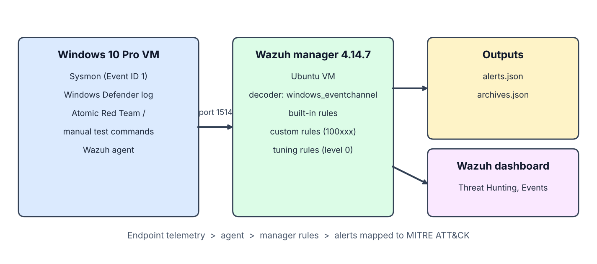
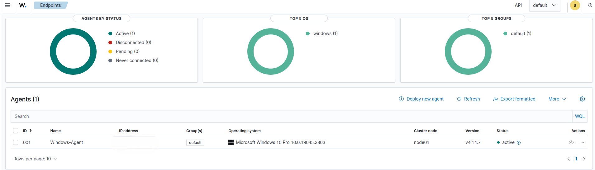
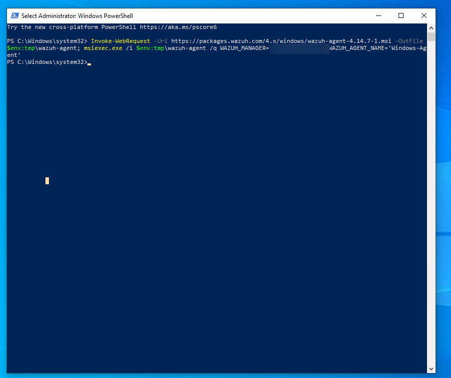
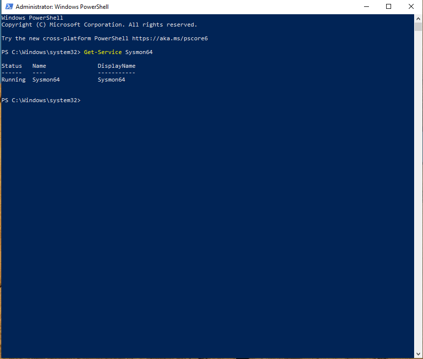
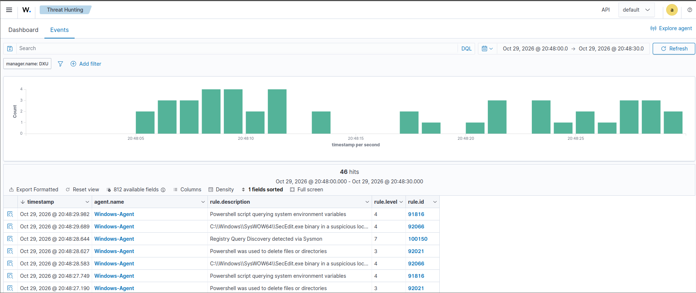
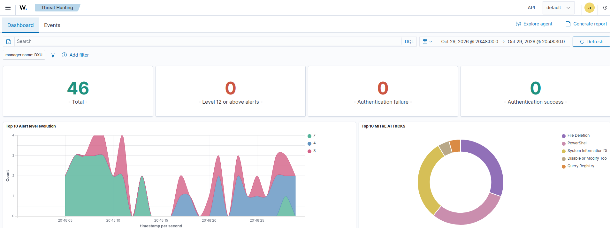
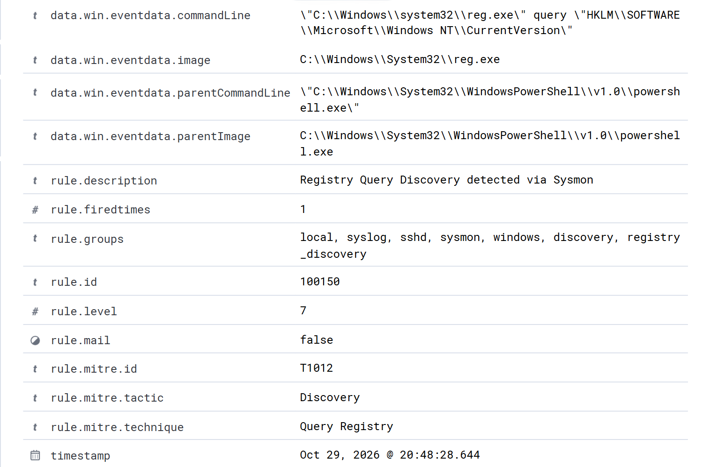
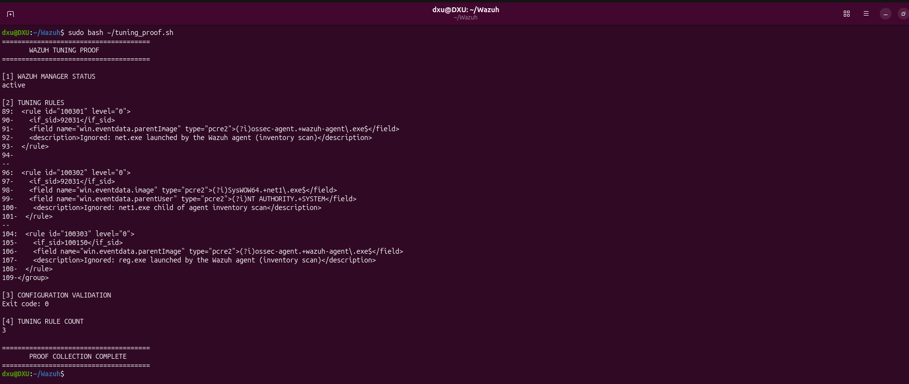
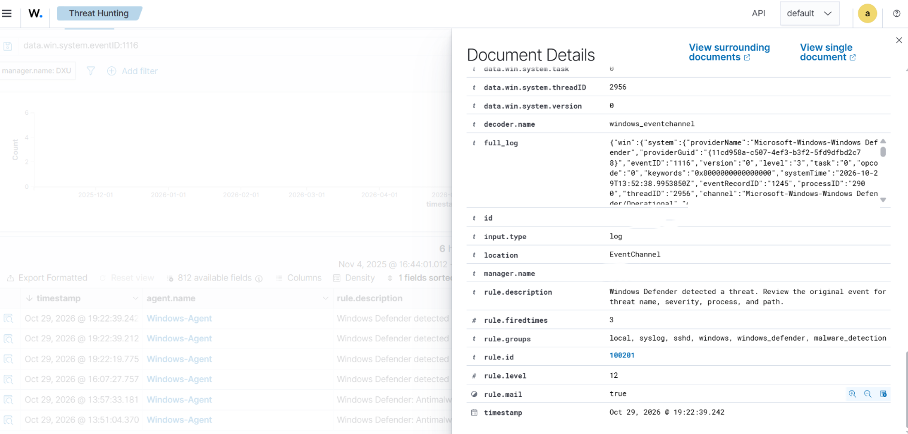

# SOC Detection & Incident Response Lab (Wazuh + Sysmon + MITRE ATT&CK)

A home lab that detects common attacker behaviours on a Windows endpoint, maps each detection to MITRE ATT&CK, tunes out false positives, and documents the troubleshooting along the way.

> Status: detection engineering and validation are complete. Case management (alert-to-case integration), triage write-ups and incident response playbooks are planned next. See [Roadmap](#roadmap).

---

## What this project shows

- Building a SIEM/EDR pipeline: endpoint telemetry (Sysmon) to Wazuh agent to Wazuh manager to alert
- Writing custom Wazuh detection rules and mapping them to MITRE ATT&CK
- Validating detections with timed test runs and matching each command to its alert
- Identifying and tuning false positives (the Wazuh agent's own scans)
- Troubleshooting a log pipeline using evidence (record IDs, timestamps, archive vs alert files)

## Lab architecture

```
Windows 10 Pro endpoint
  Sysmon (process creation, Event ID 1) + Windows Defender log
  Atomic Red Team / manual test commands
        |
  Wazuh agent
        |  (agent to manager, port 1514)
  Wazuh manager 4.14.7 (Ubuntu)
    decoder: windows_eventchannel
    rules: built-in + custom (100xxx) + tuning rules (level 0)
        |
  Alerts (alerts.json) and archived events (archives.json)
```

| Component | Role |
|---|---|
| Windows 10 Pro VM | Monitored endpoint |
| Sysmon | Records process creation with image, command line, parent process and user |
| Wazuh agent | Forwards Windows event-channel logs to the manager |
| Wazuh manager 4.14.7 (Ubuntu) | Decodes events, applies rules, raises alerts |
| Atomic Red Team | Controlled attack simulation (used for T1059.003) |





Agent installed from an elevated PowerShell prompt:





## Detections

All 8 techniques were validated with a timed controlled run. Each command was matched to its alert and MITRE tag.

| MITRE ID | Technique | Rule | Type | Trigger observed |
|---|---|---|---|---|
| T1082 | System Information Discovery | 100100 | Custom | `systeminfo.exe` |
| T1057 | Process Discovery | 100120 | Custom | `tasklist.exe` |
| T1059.003 | Windows Command Shell | 92032 | Built-in | Atomic Red Team T1059.003 test 2 |
| T1016 | System Network Configuration Discovery | 100130 | Custom | `ipconfig.exe /all` |
| T1049 | System Network Connections Discovery | 100140 | Custom | `NETSTAT.EXE -ano` |
| T1059.001 | PowerShell | 92027 | Built-in | `powershell.exe -NoProfile -Command ...` |
| T1087.001 | Local Account Discovery | 92031, 92033 | Built-in | `net user` / `net1 user` |
| T1012 | Query Registry | 100150 | Custom | `reg.exe query ...` |
| — | Defender threat detected (1116) | 100201 | Custom | EICAR test file |
| — | Defender action taken (1117) | 100202 | Custom | EICAR test file |

Notes:
- Rule 100130 also matches `netsh.exe`, `arp.exe` and `nbtstat.exe`, so it covers more than the `ipconfig` command used in the test.
- The built-in rules for account discovery (92031, 92033) tag the parent technique T1087, not the sub-technique T1087.001.
- Built-in rule 92032 carries two tags (T1087 and T1059.003), so it is broader than the technique it validates.





Example alert expanded (T1012 Query Registry, rule 100150, with rule ID, MITRE tag, command line and parent process):



Full-page capture: [`alert-detail-t1012-full.png`](docs/images/alert-detail-t1012-full.png)

### Controlled run (2026-10-30)

Commands were run manually in one PowerShell session; Wazuh alerts appeared within about 4 seconds.

| Time (IST) | Command | Rule | MITRE tag |
|---|---|---|---|
| 16:13:50 | `systeminfo` | 100100 | T1082 |
| 16:13:52 | `tasklist` | 100120 | T1057 |
| 16:13:52 | `ipconfig /all` | 100130 | T1016 |
| 16:13:52 | `netstat -ano` | 100140 | T1049 |
| 16:13:52 | `net user` | 92033, 92031 | T1087, T1059.001 |
| 16:13:52 | `powershell -NoProfile -Command Get-Date` | 92027 | T1059.001 |
| 16:13:54 | `reg.exe query "HKLM\SOFTWARE\Microsoft\Windows NT\CurrentVersion"` | 100150 | T1012 |

Only T1059.003 was validated with Atomic Red Team; the others used manual controlled commands.

## Example rules

Custom rule for T1082:

```xml
<rule id="100100" level="7">
  <if_group>sysmon_event1</if_group>
  <field name="win.eventdata.image" type="pcre2">(?i)systeminfo\.exe$</field>
  <description>System Information Discovery detected via Sysmon</description>
  <mitre><id>T1082</id></mitre>
  <group>sysmon,windows,discovery,</group>
</rule>
```

Query Registry rule, written as a child of built-in rule 92025 (see lesson 1):

```xml
<rule id="100150" level="7">
  <if_sid>92025</if_sid>
  <field name="win.eventdata.image" type="pcre2">(?i)reg\.exe$</field>
  <field name="win.eventdata.commandLine" type="pcre2">(?i)query</field>
  <description>Registry Query Discovery detected via Sysmon</description>
  <mitre><id>T1012</id></mitre>
  <group>sysmon,windows,discovery,registry_discovery,</group>
</rule>
```

Defender detection rule, a child of built-in rule 62123:

```xml
<rule id="100201" level="12">
  <if_sid>62123</if_sid>
  <field name="win.system.eventID">^1116$</field>
  <description>Windows Defender detected a threat. Review the original event for threat name, severity, process, and path.</description>
  <group>windows,windows_defender,malware_detection,</group>
</rule>
```

The full rule file is in [`rules/local_rules.xml`](rules/local_rules.xml). Evidence workbook: [`docs/evidence/Wazuh_Alert_Validation.xlsx`](docs/evidence/Wazuh_Alert_Validation.xlsx). Details: [`docs/validation.md`](docs/validation.md), [`docs/false-positive-tuning.md`](docs/false-positive-tuning.md), [`docs/troubleshooting.md`](docs/troubleshooting.md).

## False-positive tuning

The Wazuh agent's own background scan runs `net user` and `reg query` as SYSTEM. These matched the account-discovery and registry-query rules and produced alerts nobody had triggered.

How it was found: counting alerts per rule by parent process showed 92031 fired mostly with `wazuh-agent.exe` or `SysWOW64\net.exe` as the parent, and 100150 fired 4 of 6 times from `wazuh-agent.exe`.

Fix: level-0 child rules that suppress only the agent-originated events.

| Rule | Parent | Suppresses |
|---|---|---|
| 100301 | 92031 | `net.exe` launched by `wazuh-agent.exe` |
| 100302 | 92031 | `SysWOW64\net1.exe` run as SYSTEM |
| 100303 | 100150 | `reg.exe` launched by `wazuh-agent.exe` |

Verification: after tuning, the agent ran `net user` twice and `reg query` twice. Those events reached the archive but raised no alerts, while my manual `net user` and `reg query` still alerted.

Before tuning, these alerts were raised by the Wazuh agent itself (`SysWOW64\net.exe`, with `wazuh-agent.exe` as the parent), taken from the old alert files:

```
2026-10-13T16:06:56  92031  C:\Windows\SysWOW64\net.exe  net user
2026-10-28T14:08:03  92031  C:\Windows\SysWOW64\net.exe  net user
2026-10-28T16:26:48  92031  C:\Windows\SysWOW64\net.exe  net user
2026-10-28T17:59:01  92031  C:\Windows\SysWOW64\net.exe  net user
```

After tuning, the three level-0 rules are loaded and the configuration validates (exit code 0):



Known limitation: rule 100302 cannot check that the event came from the agent (the parent is `net.exe`), so it would also hide a SYSTEM-run 32-bit `net1.exe user`. Acceptable in a lab; in production, narrow it further.

## Troubleshooting log: missing Defender events 1116/1117



| Problem | Cause | Fix |
|---|---|---|
| Events seemed missing | Windows VM was on Pacific time, manager on IST | Set the VM to India Standard Time |
| Keyword searches "found" events | Searches matched my own `sudo` commands and PowerShell events with the same record IDs | Filter by location and provider, compare record IDs |
| Oct 28 20:51 events never archived | Agent only began reading the Defender channel at 21:01 IST | Events before then are not recoverable in Wazuh |
| Events delayed about 28 minutes | Agent restarted while the manager was down; reader stalled until the service was restarted | Restart the agent after any manager outage and verify with a test |
| No new events after a VM reboot | Manager did not start again | `systemctl start` and `enable` the manager |

## Key lessons

1. **A custom rule shares a parent with a built-in rule, and the built-in one matches first.** The custom rule never fires. Find the blocking rule in `/var/ossec/ruleset/rules/` and make yours a child with `<if_sid>`. This fixed 100201, 100202 and 100150.
2. **An alert existing does not prove your test caused it.** Check the parent process and command line.
3. **Verify a pipeline end to end** after any restart: restart the agent, run a test, check the archive, then the alerts.
4. **Keep time zones consistent** across all systems, or every log comparison turns into guesswork.

## How to reproduce

1. Install Wazuh manager and dashboard on Ubuntu, and the Wazuh agent on Windows.
2. Install Sysmon and configure the agent to collect `Microsoft-Windows-Sysmon/Operational` and `Microsoft-Windows-Windows Defender/Operational`.
3. Enable archives (`logall_json`) on the manager for debugging.
4. Add the rules to `/var/ossec/etc/rules/local_rules.xml`, validate with `/var/ossec/bin/wazuh-analysisd -t`, then restart the manager and restart the Windows agent.
5. Run the test commands and check `/var/ossec/logs/alerts/alerts.json`.

## Repository structure

```
soc-detection-lab/
├── README.md
├── LICENSE
├── .gitignore
├── rules/
│   └── local_rules.xml              custom detection and tuning rules
├── config/
│   ├── agent-ossec-localfile.xml    channels the Windows agent collects
│   └── manager-ossec-global.xml     JSON archive setting
├── docs/
│   ├── setup.md                     how to build the lab
│   ├── validation.md                results and the controlled run
│   ├── false-positive-tuning.md     agent noise and the fix
│   ├── troubleshooting.md           missing Defender events
│   ├── evidence/
│   │   └── Wazuh_Alert_Validation.xlsx
│   └── images/                      screenshots
└── queries/
    └── useful-commands.md           jq and PowerShell checks
```

## Disclaimer

This is an isolated learning lab. The test commands are harmless discovery commands and the EICAR test file, which is a
standard antivirus test string and not real malware. Do not run these tests on machines you do not own.

## Roadmap

- [ ] Alert-to-case integration with a case management platform
- [ ] Triage write-ups: 4-6 cases with true/false positive reasoning
- [ ] 2-3 incident response playbooks (PowerShell execution, discovery burst, Defender malware detection)
- [ ] Atomic Red Team attribution for the remaining techniques

## Tools

Wazuh 4.14.7 · Sysmon · Atomic Red Team · MITRE ATT&CK · Windows Defender · VMware Workstation

## Author

DXU (Dharmesh) · [LinkedIn](https://linkedin.com/in/dharmesh001/) · [GitHub](https://github.com/Dharmeshvsd)